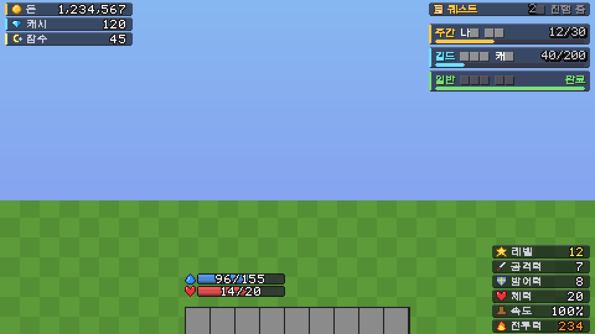
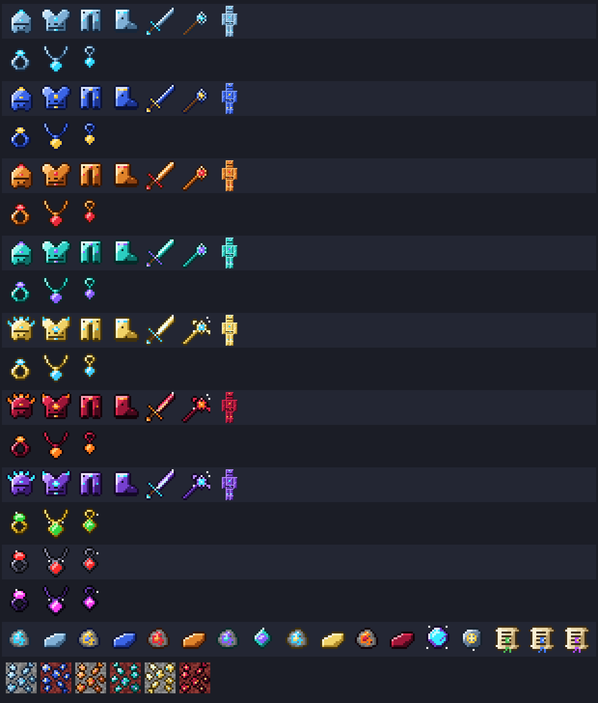

# mc-server

서버 프레임워크 없이 `tokio`만 쓰는 마인크래프트 Java Edition **26.3** (프로토콜 **777**) 서버.
암호(RSA·AES·SHA)와 압축(zlib)까지 직접 구현했고, 외부 구현은 Mojang 세션 서버와의
HTTPS(TLS) 하나뿐입니다 (`rustls`, 직접 짠 TLS는 보안 구멍이 되기 쉬워서).

```bash
cargo run --release                # 0.0.0.0:25565, 월드는 ./world, 정품 인증 켬
MC_ONLINE_MODE=false MC_GAMEMODE=creative cargo run --release
cargo test
```

| 환경 변수 | 기본값 | 뜻 (`server.properties` 대응) |
|---|---|---|
| `MC_BIND` | `0.0.0.0:25565` | 주소 |
| `MC_WORLD` | `world` | 기본 폴더 (인스턴스 목록·권한·인스턴스별 월드) |
| `MC_SEED` | `20260915` | 처음 만들 때의 시드 |
| `MC_INSTANCES` | `main` | 처음 켤 때 만들 인스턴스: `이름[:시드[:모드]]`, 쉼표로 |
| `MC_PREGEN` | `8` | 새 월드를 만들 때 스폰 둘레를 미리 만들 반지름(청크, 0 = 안 함) |
| `MC_ONLINE_MODE` | `true` | `online-mode` |
| `MC_COMPRESSION` | `256` | `network-compression-threshold` (음수 = 끔) |
| `MC_GAMEMODE` | `survival` | `gamemode` (처음 들어온 사람) |
| `MC_SPAWN_MOBS` | `true` | 몹 자연 스폰 |
| `MC_OPS` | (없음) | 처음 들어오면 OP 4가 될 이름, 쉼표로 (`ops.json`에 기록) |
| `MC_EVERYONE_OP` | `false` | 모두를 OP 4로 (혼자 시험할 때) |
| `MC_DIFFICULTY` | `normal` | `peaceful` `easy` `normal` `hard` |
| `MC_HARDCORE` | `false` | 하드코어 (죽으면 관전 모드) |
| `MC_OFFLINE_SKINS` | `false` | 오프라인 모드에서 같은 이름의 정품 스킨 빌리기 |

## 인스턴스 (한 포트에 여러 서버)

서버 하나에 **인스턴스**를 여러 개 둘 수 있습니다. 인스턴스마다 월드(지형 시드·바뀐 블록)·
몹·상자·플레이어 저장·접속자 목록·채팅·시간·난이도·기본 게임 모드가 따로이고, OP·권한·밴·
화이트리스트·정품 인증·사용자 정의 아이템은 함께 씁니다. BungeeCord·Velocity처럼 플레이어를
옮기지만 프록시 없이, 클라이언트를 Configuration 단계로 되돌렸다가(`Start Configuration`)
다른 인스턴스의 Play로 들여보냅니다.

```
world/
  instances.json      인스턴스 목록 (기본 인스턴스, 이름·폴더·시드·모드·난이도·하드코어)
  ops.json …          권한·밴 (네트워크 전체)
  custom_items.json
  lobby/              인스턴스마다: level.json, blocks.dat, containers.dat, players/
  survival/
```

- 처음 켤 때 `instances.json`이 없으면 `MC_INSTANCES`(없으면 `main` 하나)로 만들고, 각 폴더에
  `level.json`(이름·시드·만든 때·생성기 판·스폰)을 씁니다. 예전 단일 월드(`world/blocks.dat`)는
  그대로 첫 인스턴스가 됩니다.
- `/server [이름]` 목록·이동 (권한 `dangu.server.<이름>`으로 막을 수 있음),
  `/instance list|create|remove|default` 실행 중에 만들고 내리기 (OP 4).

## 담비 마스터 노드 (인스턴스마다 독립 프로세스)

`mc-server master`는 **마스터 노드**(프록시 + 관리자 CLI)로 켜지고, 컨텐츠 월드(마을·야생·RPG
…)마다 자기 실행 파일을 `child` 모드의 **독립된 OS 자식 프로세스**로 띄웁니다. 자식 하나 =
인스턴스 하나 = 오버월드·네더·엔드 세 차원.

```
플레이어 ──▶ 마스터 :25565 ──(핸드셰이크·Login Start만 읽고 라우팅)──▶ 127.0.0.1:25601 마을
              │  CLI (stdin)                                       ├──▶ 127.0.0.1:25602 야생
              └─ IPC: 유닉스 소켓 dambi/master.sock, [u32 길이][JSON] ┴──▶ 127.0.0.1:25603 rpg
```

```bash
DAMBI_HOME=dambi MC_BIND=0.0.0.0:25565 cargo run --release -- master
> instance start rpg --ram 4G        # = 인스턴스 시작 rpg --램 4G
> instance list                      # pid, 포트, 접속자, 램 사용/할당, cgroup 여부
> move Steve rpg                     # = 이동 Steve rpg
> money Steve give 1000 cash         # = 재화 Steve 지급 1000 캐시
> broadcast 10분 뒤 점검              # = 공지 … (모든 인스턴스)
> send rpg time set night            # 그 인스턴스 콘솔에서 실행
> stop                               # 모두 저장하고 끔
```

- **라우팅**: 프록시는 핸드셰이크와 Login Start(이름)만 읽고 그 뒤로는 바이트를 그대로 잇습니다
  (정품 인증·암호화·압축은 인스턴스가 직접). 진짜 IP는 핸드셰이크 주소 칸에
  `주소\0IP`로 실어 넘기고, 자식은 127.0.0.1에서만 들으므로 위조할 수 없습니다. 서버 목록
  핑은 마스터가 모든 인스턴스 접속자 합으로 답합니다.
- **인스턴스 이동**: 바닐라 **Transfer 패킷**. 자식이 `TransferRequest`를 보내면 마스터가
  "이 이름은 다음 접속 때 rpg로"라고 적어 두고, 자식이 클라이언트에게 Transfer(처음 접속한
  주소)를 보냅니다. 다시 들어오면 프록시가 rpg 프로세스로 잇습니다. LocalData(차원·좌표·체력·
  인벤토리)는 떠난 인스턴스의 플레이어 파일에 남고 새 인스턴스는 자기 것을 씁니다(Drop → Swap).
- **SharedData**는 마스터만 고칩니다: 돈·캐시·잠수포인트, 누적 플레이 시간(접속~퇴장, 5초마다
  정산), 생활 직업 레벨(필요 경험치 `3.0 × 레벨² + 300.0`, 전직 초기화 시 80% 환급). 마스터
  메모리에 캐시하고 바뀐 것만 5초마다 `dambi/shared/<uuid>.json`에 씁니다.
- **램 할당량**: cgroup v2를 쓸 수 있으면 `<cgroup>/dambi/<이름>/memory.max`로 커널이 막고,
  언제나 `/proc/<pid>/status` RSS를 2초마다 봐서 90%면 경고, 3번 연속 넘으면 저장·종료 후
  다시 켭니다. 비정상 종료(켠 지 30초 넘은 것)도 다시 켭니다.
- **전역 버스**: 자식의 `dambi::child::publish(채널, 내용)` → 마스터 → 모든 인스턴스의
  `subscribe(채널, …)`. `broadcast` 채널은 채팅 공지로 보입니다. 같은 JSON 메시지를 Redis 등
  다른 버스로 옮겨 실을 수 있게 형식을 단순하게 두었습니다.
- 게임 안 명령어: `/재화 [보내기 <이름> <양>]`, `/이동 [인스턴스]`. 마스터 없이 켠 서버에서도
  `/재화`는 그 서버 안의 저장소(`world/shared/`)로, `/이동`은 프로세스 안 인스턴스로 동작합니다.
- 설정: `dambi/dambi.json`(인스턴스 이름·포트·램·시드·모드·자동 시작). 처음 켜면 마을·야생·rpg.
  월드는 `dambi/instances/<이름>/`.
- 아직 없는 것: Wasm 플러그인 핫 리로딩(`wasmtime`), Redis 버스, 광부·강화 등 컨텐츠 로직은
  이 뼈대 위에 올릴 다음 단계입니다 (의존성을 `tokio`로 묶어 두었기 때문).

## 채팅 채널 (`/채널`)

| 채널 | 앞 기호 | 누가 받나 |
|---|---|---|
| 전체 | `!` | 모든 인스턴스의 모두 (3초 도배 막기) |
| 채널 | `%` | 같은 인스턴스 (처음 기본값) |
| 주변 | `~` | 같은 차원 64칸 안 |
| 거래 | `$` | 모두 (10초 도배 막기, 끌 수 있음) |
| 길드 | `@` | 같은 길드원 (모든 인스턴스) |
| 관리자 | `#` | `dangu.chat.staff` 권한 (기본 OP 2) |

- 그냥 치면 지금 채널로, 앞에 기호를 붙이면 그 한 번만 그 채널로 (`!안녕`).
- `/채널 <이름>` 기본 채널 바꾸기, `/채널 끄기|켜기 <이름>` 받기 끄고 켜기, `/채널` 목록(누르면 바뀜).
- 한 줄 모양: `[전체] [광부].(Lv.12) Alex : 안녕` — 대표 직업(가장 높은 레벨)과 그 레벨. 직업이
  없으면 `[무직]`. 길드 채널은 `[길드이름]`.
- 이름에 마우스를 올리면 직업들(레벨순 4개)·길드와 역할·전투력·있는 곳(인스턴스)·놀이 시간이 보이고,
  누르면 `/msg 이름 `이 채팅 창에 들어갑니다. 이 정보는 보낸 쪽이 만들어 담비 버스로 같이 보냅니다.
- 담비 마스터 아래에서는 전역 버스(`dangu:chat`)로 다른 프로세스에도 갑니다.
- 채널 채팅은 머리말(`[전체]`)을 붙이려고 서명 없는 시스템 메시지로 보냅니다. 바닐라 서명 채팅이
  필요하면 `MC_CHAT_CHANNELS=0`.
- 고른 채널·끈 채널은 프로세스가 켜져 있는 동안만 기억합니다.

## HUD (재화·퀘스트·스탯·체력·마나)



- **왼쪽 위**: 돈 · 캐시 · 잠수 포인트 카드 (색 줄무늬 + 아이콘 + 라벨 + 값)
- **오른쪽 위**: 퀘스트 — 머리(진행 중 개수) 아래로 퀘스트 카드 최대 3개: 종류(주간 금색·길드
  하늘색·일반 초록), 이름(길면 `..`), 진행 `12/30` 또는 `완료`, 진행 막대. `/퀘스트` 창에서 누른
  퀘스트가 따라다니고, 고른 것이 없으면 끝나지 않은 주간·길드·일반 순.
- **오른쪽 아래**: 레벨 · 공격력 · 방어력 · 체력 · 속도 · 전투력 (한글 라벨 알약 모양)
- **핫바 위**: 체력바(바닐라 하트 자리)와 마나바(갑옷 아이콘 자리), 왼쪽에 아이콘·가운데 숫자.
  바닐라 하트·갑옷 아이콘은 투명 그림으로 숨김.
- `/hud` 재화·퀘스트·스탯 판 끄기/켜기 (체력·마나바는 남음). `MC_HUD=0`이면 HUD 전체와 하트 숨김을 끔.
- 리소스 팩을 받은 사람에게만 보냅니다. 다른 기능이 액션바에 글을 띄우면 3초 쉽니다.

어떻게:
- 위쪽은 분홍 보스바 최대 4개의 제목(19px 간격; 막대 그림은 투명), 아래쪽은 액션바 글 한 줄.
  줄마다 폭을 0으로 맞춰 화면 가운데를 원점으로 쓰고, 가로 자리는 공백 글자(±2^k px)로 잡습니다.
- 글자 색 `#FD gg bb`가 표시입니다: `gg` = 기준점(08 오른쪽 끝, 0C 가운데, 10 왼쪽 끝), `bb-0xF0` =
  16색 팔레트 번호. 팩에 넣은 `core/text.vsh`(바닐라 26.3 원본에 몇 줄 더함 — 26.3에서 글자를 그리는
  셰이더는 이것 하나)가 글자를 화면 반 폭만큼 옮기고 팔레트 색을 입히므로, 서버가 화면 크기를 몰라도
  끝에 붙고 그림판은 흰색·회색조 하나로 여러 색을 냅니다.
- 그림 글자(숫자·아이콘·카드·막대)는 줄 높이마다 `ascent`만 다른 비트맵 폰트(`dangu:hud/t0`…).
  한글 라벨은 GNU Unifont(OFL)에서 뽑은 글자 41개.
- 퀘스트 이름처럼 바뀌는 글은 `dangu:hud/text` 폰트로 그립니다: 바닐라 `include/space`·`default`·
  `unifont`를 그대로 참조해 생김새는 바닐라 글자와 같지만, 바닐라 `minecraft:default`와 달리
  "유니코드 글꼴 강제" 옵션에 따라 바뀌지 않으므로 서버가 계산한 폭(ascii.png 잉크 폭 + 1, 한글 음절
  8, 자모·한자 9)과 늘 같습니다. 폭을 모르는 글자는 빼고 보냅니다.
- 위 그림은 `MC_HUD_PREVIEW=out.png cargo test hud_preview -- --ignored`가 같은 계산과 바닐라 글자
  그림(ascii.png, unifont)으로 GUI 배율 2에서 그린 것입니다 (실제 클라이언트 스크린샷은 아님).
- 글자 자료는 `tools/gen_hud_font.py`가 바닐라 에셋과 unifont에서 만듭니다 (`hud/glyphs.rs`).

**마나** (`plugins/rpg`): 최대 100 + (레벨-1)×5, 초당 2 + 최대/50 회복, 부활하면 가득. 사용자 정의
아이템 능력에 `mana_cost`(기본 아이템: 번개 20, 순간 이동 10 …)가 있으면 그만큼 쓰고, 모자라면
"마나가 부족합니다". 크리에이티브는 공짜. 접속할 때마다 가득 찬 채로 시작 (저장하지 않음).

## 길드 (`/길드`)

`/길드`를 치면 창이 열립니다 (길드가 없으면 공개 길드 목록, 누르면 가입 신청).

| 기획 | 구현 |
|---|---|
| 길드 정보: 이름·레벨·길드장·인원·전투력 | 메인 창 맨 위. 전투력 = 길드원 전투력 합 (RPG 스탯, 30초마다 갱신) |
| 길드 창고 (페이지) | 6줄 창, 위 45칸이 진짜 칸. 넣고 빼면 기록이 남음. 페이지는 창고 업그레이드로 1→6 |
| 땅 관리: 좌표 · 좌클릭 이동 · Shift+좌클릭 판매 후 확인창 | 청크 단위 10,000원, 처음 뒤로는 붙은 청크만, 판매 시 절반 환불 |
| 땅 보호 · 방문객 관리 | 길드원·방문객만 부수기/놓기/상자·문. 크리에이티브 OP는 예외 |
| 입장·퇴장 메시지 | 길드 땅에 들어가면 제목, 나가면 액션바 |
| 길드 레벨별 효과 | 레벨표(누적 경험치·최대 인원·땅·창고 쪽수·신호기 칸·직업 경험치 보너스·희귀 보너스)를 `world/guild_config.json`에서 — 웹 관리 화면으로 고침 |
| 업그레이드 (방벽 = 아직 못 여는 것, 회색) | 땅·인원·창고 (단계마다 더하는 값·최대 단계·비용·필요 레벨은 설정). 값은 내 돈, 길드 레벨 조건 |
| 작물 성장 (청크별) | 길드 땅 전체가 아니라 청크마다 단계. `/길드` → 청크 지도(9×5, 위가 북쪽)에서 우리 청크를 Shift+좌클릭하거나, **작물 성장 촉진제**(`dangu:crop_booster`)를 우클릭해 연 지도에서 좌클릭 → 촉진제 하나로 그 청크 +1단계. 단계별 배율은 설정(기본 ×1·1.25·1.5·1.75·2·2.5). 지도에서 붙은 빈 청크 Shift+좌클릭으로 사기도 함 |
| 신호기: 범위 무제한·무한 지속 | 9가지 효과. n번째 효과 = 신호기 n개, 단계 올리기 = 철·금·다이아·에메랄드 + 돈 |
| 퀘스트 | 퀘스트 플러그인의 "길드 주간" (아래 퀘스트 참고) |
| 2배 이벤트: 생활 직업 경험치 · 높은 등급 재료 확률 | GP 500으로 1시간. 광부(광석)·농부(다 자란 작물)·나무꾼(통나무) 경험치, 광석 덤 5%→10% |
| 역할: 길드장 · 부길드장(2명) · 길드원 | 권한 13가지를 역할 관리 창에서 켜고 끔. 위임·임명·역할 관리·해산은 길드장만 |
| 해산(물어보기) · 탈퇴 · 강퇴 · 가입 신청(수락/거절) · 비공개 · 설명 | 모두 창에서, 글은 `/길드 설명 <글>` 처럼 |
| 미정: GP·공헌도·경험치·명예훈장 | 하나로: 퀘스트 GP가 길드 경험치(레벨)와 쓸 수 있는 GP로 쌓이고, 끝낸 사람 공헌도에도 더함. 길드 상점은 회색 방벽(준비 중) |

- 채팅 `@글` 또는 `/채널 길드`는 길드원끼리 (모든 인스턴스).
- 저장: `MC_GUILDS` (기본 `world/guilds.json`) 하나를 모든 인스턴스·담비 자식 프로세스가 같이 씀
  (잠금 파일로 차례를 지키고, 0.5초마다 바뀌었는지 봄). 설정 `MC_GUILD_CONFIG`(기본
  `world/guild_config.json`)도 같은 방식이라 고치면 서버를 다시 켜지 않아도 곧바로 적용.
- 길드 창고는 기본으로 모든 인스턴스에서 열리고, 설정 `storage_blocked_instances`에 적은 인스턴스에서만
  막힙니다.
- 신호기 효과: 성급함·점프·야간 투시·화염 저항·수중 호흡은 효과 패킷으로, 신속은 이동 속도 속성도
  보내고, 힘(+3/단계)·저항(-20%/단계)·재생(초당 0.4/단계)은 서버가 피해·회복에 반영.
- 아직: 길드 스폰·땅 이동은 같은 채널(인스턴스) 안에서만, 길드 상점 없음, 실제 클라이언트로는
  확인 못 함 (패킷 테스트만).

## 퀘스트 (`/퀘스트`)

| 종류 | 받는 법 | 새로 고침 |
|---|---|---|
| 일반 | 창에서 좌클릭으로 수락 (Shift+우클릭 포기), 반복 가능 여부는 퀘스트마다 | — |
| 주간 | 저절로 (모두 같은 퀘스트) | 매주 월요일 0시(한국), 후보 중 `weekly_count`개 |
| 길드 주간 | 길드에 저절로, 길드원 진행이 합쳐짐 | 같음, `guild_weekly_count`개. GP는 길드에, 나머지 보상은 마지막에 채운 사람 |
| **일일 납품** | 저절로, 사람마다 자원 1~3가지 | 매일 0시(한국). 모두 내면 자동심기 50 · 플라이 30분 |
| **주간 납품** (주간 탭) | 저절로, 1~3가지 × 3배 개수 | 월요일 0시. 모두 내면 자동심기 100 · 플라이 60분 |
| **길드 납품** (길드 탭) | 길드마다 1~3가지 × 2배, 길드원이 함께 | 매일 0시. 모두 내면 길드 GP 300, 낸 길드원 모두 자동심기 50 · 플라이 30분 |

납품 자원 (일일 개수): 광물 — 조약돌 32, 흑요석 5, 석탄 16, 구리 16, 철 8, 금 4, 청금석 16, 레드스톤 16 ·
물고기 — 아로와나·잉어·피라미 5 · 농부 — 감자, 배추, 쌀, 아스파라거스, 파프리카, 산삼 3 · 고기 — 소·닭·양·돼지 3 ·
나무 — 목재 32, 목재 묶음 1 ×1, 목재 묶음 2 ×2, 황금사과 1. 광석은 원석이든 주괴든 받습니다.
**물고기·배추·쌀·아스파라거스·파프리카·산삼·목재 묶음은 아직 아이템이 없어서** (`dangu:carp` 같은 이름만
잡아 둠) 뽑히지 않고, 그 콘텐츠를 넣으면 저절로 뽑히기 시작합니다. 자동심기·플라이는 후원 등급과 같은 것
(`/플라이`로 남은 시간). 웹 관리 화면 퀘스트 탭에서 자원·개수·배율·보상을 고칩니다.

- 목표: `mine`(아무 블록) · `ores` · `logs` · `harvest`(다 자란 작물) · `kill`(몹) · `deliver`(창에서 눌러
  가방의 아이템 내기). 거르기에 `*` 하나 (`*_ore`).
- 보상: 돈·캐시·아이템(커스텀 아이템 id 가능)·직업 경험치·길드 GP·자동심기·플라이 시간. 끝나면 제목과 채팅으로 알림.
- 창에서 진행 중 퀘스트를 누르면 HUD 오른쪽 위에 따라다님 (최대 `max_tracked`개, 1~3).
- 내용: `MC_QUESTS` (기본 `world/quests.json`), 진행: `MC_QUEST_PROGRESS` (기본
  `world/quest_progress.json`). 웹 관리 화면에서 고칩니다.

## 웹 관리 화면

서버를 켜면 `웹 관리 화면: http://127.0.0.1:25580/#token=…`이 찍힙니다. 한 화면에서

- **길드**: 레벨별 효과 표(행 추가·빼기), 강화, 청크 작물 단계 배율, 창고를 막을 인스턴스, 그 밖의 값
- **퀘스트**: 일반·주간·길드 주간 퀘스트 카드(추가·지우기·순서), 주간 개수, HUD 개수
- **장비**: 강화 확률표, 잠재 옵션, 주문서, 보스, 대장간 상점
- **서버**: 후원 등급 표(특혜 × 등급, 등급 추가·빼기), 홈·tp 대기·잠수 보상, 금지 아이템 목록
- **JSON**: 설정 파일 원문 그대로

을 고치고 **저장**하면 모든 설정을 먼저 함께 확인한 뒤(하나라도 틀리면 아무것도 저장 안 함) 파일에 쓰고,
모든 인스턴스가 0.5초 안에 다시 읽습니다.

- `MC_ADMIN_PORT` (기본 25580, 0이면 끔), `MC_ADMIN_BIND` (기본 `127.0.0.1` — 이 컴퓨터에서만).
  밖에서 쓸 때는 SSH 터널(`ssh -L 25580:127.0.0.1:25580 서버`)을 권합니다 (HTTPS 아님).
- 토큰: `MC_ADMIN_TOKEN`, 없으면 `world/admin_token.txt`(`MC_ADMIN_TOKEN_FILE`)에 만들어 둡니다.
  주소의 `#token=`은 서버로 가지 않고 브라우저 탭에만 남습니다. API는 `Authorization: Bearer`.
- API: `GET/PUT /api/guild-config`, `/api/quests`, `/api/equipment`, `/api/ranks`, `/api/rules`,
  `…/default`(기본값), `X-Dry-Run: 1`(확인만).

## 장비 (`/장비` · `/강화` · `/대장간`)



| 기획 | 구현 |
|---|---|
| 제작 장비: 모자·상의·하의·신발, 무기, 반지·목걸이·귀걸이 | `/대장간`에서 광물 주괴로. 단계가 높을수록 직업 **대장장이** 레벨이 필요 (5단계마다), 만들면 대장장이 경험치 |
| 보스 장비: 고티 재료(마석)로 대장장이가 제작, 보스 악세(제작보다 좋음) | 보스가 마석·강화석·원석·보스 악세·주문서를 떨굼. 마석 + 세라피움·이블리움으로 최상위 **아르카나** 세트 |
| 갑옷·무기 (공격력 or 마법력, HP or MP, 방어력) = 세트 효과 | 검: 공격력·HP, 지팡이: 마법력·MP, 모자·신발: 방어력·MP, 상의·하의: 방어력·HP. 같은 세트 2·3·5개 효과 (`/장비` 창에서 켜진 것 초록) |
| 악세 (치확, 치피) = 잠재력 효과 | 반지 치명타 확률, 목걸이 크리티컬 피해, 귀걸이 둘 다 + 잠재능력 |
| 최대 30강, 할수록 확률이 낮아짐, 악세는 강화 없음 | `/강화`: +1 95% … +10 50% … +20 14% … +30 1%. 단계마다 기본 능력치 +5%, +10·+20·+30에서 +10% 더 (+30 = 2.8배). 돈·강화석, 실패해도 단계 유지. +15부터 5단계마다 서버 알림 |
| 잠재력은 악세마다 바를 수 있는 횟수, 원하는 옵션이 안 뜨면 새로 구함 | 제작 악세 3번, 보스 5번, 레이드 7번. 바를 때마다 전부 다시 뽑음 |
| 주문서: 하급(상점, 1~2줄), 중급(던전, 2~3줄), 상급(레이드에서만 50%로 1개, 3~4줄) | 하급: 대장간 상점. 중급: 보스 (던전 생기면 거기에도). 상급: 레이드 보스 "심연 군주" 50% |
| 아이템을 장비에 drop하면 옵션이 붙음 | 가방에서 주문서를 집어 악세 위에 놓으면 (어느 창에서든) |
| 잠재: 힘·민첩·지능, 체력·마력·공격력·방어력(깡/퍼), 치명타 확률, 크리티컬 피해 | 그대로. 힘 1 = 공격력 1%·체력 0.5%, 민첩 1 = 치확 0.2%p·치피 0.5%, 지능 1 = 마법력 1%·마력 0.5% |
| 광물: 미스릴·오리하르콘·세라피움(오버월드), 코발트·소울 크리스탈·이블리움(지옥) | 월드 생성에 광석 블록 (깊을수록 좋은 것). 미스릴·코발트는 철 곡괭이, 나머지는 다이아 이상. 캐면 원석(30%로 2개) + 광부 경험치 → 대장간에서 원석 2개 = 주괴 1개 |
| 마석 = 상급 | 보스 재료, 반짝임 |

- 세트 7종(미스릴 → 코발트 → 오리하르콘 → 소울 크리스탈 → 세라피움 → 이블리움 → 아르카나) × 6부위,
  제작 악세 18종, 보스 악세 9종(고블린 왕·타락한 기사·심연 군주). 그림은 모두 코드로 만든 도트
  (`plugins/equip/art.rs`: 부위 틀 + 재질 팔레트 + 자동 명암·테두리, 단계마다 검·지팡이·투구 모양이 바뀜),
  입었을 때 겉모습(64×32 갑옷 텍스처)도 세트마다. 위 그림은
  `MC_EQUIP_PREVIEW=out.png cargo test equipment_showcase -- --ignored`.
- 전투에 실제로 들어감: 근접 피해 = 공격력 ÷ 5 (치명타면 × 크리티컬 피해), 받는 피해 × 100/(100+방어력),
  체력은 RPG 체력(맨손 100)으로 나눠 씀, 아이템 능력(번개 등)은 × (1 + 마법력/100). HUD 오른쪽 아래와
  `/장비` 창의 능력치 책에 모두 보임.
- 장비 한 개 한 개는 일련번호로 구별 (`world/gear.json`: 강화 단계·잠재·남은 횟수·낀 악세). 이름·설명은
  그 번호로 그때그때 (`+12 미스릴 투구`, 강화 막대, 세트 효과, 잠재 줄).
- 보스: `/보스 목록`, `/보스 소환 <id>` (OP). 좀비·위더 스켈레톤이 자연히 생길 때 0.3~0.4%로 보스가 됨
  (서버 알림). 이름표·체력·공격 배율, 잡으면 서버 알림.
- 수치·확률·조합법·드랍·광석 생성은 `world/equipment.json` — 웹 관리 화면의 **장비** 탭(강화 확률표,
  잠재 옵션, 주문서, 보스, 상점)과 JSON 탭. 고치면 모든 인스턴스에 곧바로.
- `/장비 지급 <id> [개수]` (OP)로 장비·재료를 받아 볼 수 있음.
- 아직: 던전·레이드가 없어 중급 주문서는 보스에서만, 상급은 소환한 레이드 보스에서만. 근접 이외
  (화살·폭발)의 몹 피해에는 보스 공격 배율이 안 들어감. 실제 클라이언트로는 확인 못 함 (패킷 테스트).

## 후원 등급 (`/등급`)

| 특혜 | Budget 9,900원 | VIP 19,900원 | MVP 39,900원 | 구현 |
|---|---|---|---|---|
| `/ec` `/제작대` `/수리` | ✔ | ✔ | ✔ | 개인 엔더상자 27칸(모든 인스턴스 같음), 어디서나 작업대. 수리는 내구도가 없는 서버라 안내만 |
| 마을 내부 플라이 무한 | ✔ | ✔ | ✔ | 우리 길드 땅 청크 위에서 서바이벌 날기 (나가면 꺼지고 다음 착지 낙하 피해 없음) |
| 더블점프 | ✔ | ✔ | ✔ | 공중에서 스페이스 두 번 → 바라보는 쪽으로 한 번 더 뜀, 땅에 닿으면 다시 |
| 셋홈 + | 1 | 2 | 3 | 기본 1개. `/셋홈 [이름]` `/홈 [이름]` `/홈목록` `/홈삭제 <이름>` |
| tp 쿨타임 | -30% | -50% | 없음 | `/홈` 다시 쓰기까지 (기본 30초) |
| 인벤세이브 | | ✔ | ✔ | 죽어도 가방·갑옷 그대로 |
| 잠수보상 | 1배 | 2배 | 2배 | 2분 넘게 안 움직이면 1분마다 잠수 포인트 (기본 1, 인스턴스 제한 가능) |
| 자동심기 | | +10만 | +20만 | 다 자란 밀·당근·감자·비트·네더 사마귀·코코아를 캐면 그 자리에 다시 심음 (블록 수 차감) |
| 경험치 부스트 | | | 2배 | 모든 직업 경험치 |
| 갑옷 숨기기 | ✔ | ✔ | ✔ | `/갑옷숨기기`: 남에게 내 갑옷이 안 보임 |
| 추천·프리미엄 출석·경매장(수수료·판매 +10/+20)·셜커 열기·인벤 자동판매 | | | | 값만 있음 — 그 기능(추천·출석·경매장·셜커 내용 저장·판매가)이 아직 없음 |

- 주기: `/등급 설정 <이름> <budget|vip|mvp|없음> [일]` (OP 4, 콘솔에서도. 0일 = 영구, 끝나면 저절로 사라짐).
  `/등급 플라이 <이름> <분>`, `/등급 자동심기 <이름> <개수>`. 등급이 생기면 서버 알림.
- 채팅 머리말에 `[VIP]` (등급 색), 이름 위 설명에 후원 등급.
- 남의 갑옷도 이제 보입니다 (전에는 손에 든 것만 보였음) — 그래서 "갑옷 숨기기"가 의미가 있습니다.
- 등급 표 `world/ranks.json`(웹 관리 화면 **서버** 탭), 사람마다 등급·홈·자동심기·플라이 시간·엔더상자는
  `world/rank_players.json`. 모든 인스턴스가 함께 씁니다.
- 결제 연동은 없습니다 (돈을 받으면 관리자가 `/등급 설정`).

## 퀵메뉴 (Shift+F · `/메뉴`)

웅크린 채 F(손 바꾸기)를 누르면 손은 그대로 두고 퀵메뉴가 열립니다.

- **메인 (서버 이동)**: 광장 · 마을 · 야생 · 던전(모험가 길드·일반 던전·성장 던전) · 레이드(준비 중).
  광장을 Shift+클릭하면 자세한 워프(상점·잠수·낚시터·대장장이·치장·캐시상점·무역섬·경매장·잠광).
  인스턴스가 정해지지 않았거나 없는 곳은 "준비 중"으로 회색. 대장장이(강화)는 바로 `/대장간`을 엶.
- **서브 (왼쪽부터)**: 내 정보 · 길라잡이 · 우편함(준비 중) · 후원(`/등급`) · 위키·디스코드·마인리스트(채팅에
  누르면 열리는 주소) · 설정 · 쓰레기통.
- **내 정보** (`/내정보`): 이름·등급·길드·레벨·전투력·대표 직업·재화·놀이 시간이 적힌 종이, 생활 스탯
  (`/직업`: 광부·농부·나무꾼·대장장이 레벨과 경험치 막대), 모험가 스탯(`/모험가`: 공격력·마법력·체력·마나·
  방어력·치명타, 장비 창 바로가기), 도감(준비 중).
- **설정**: HUD 켜기/끄기, 갑옷 숨기기(후원), 플라이 남은 시간, 채팅 채널 6개 받기/끄기. (BGM·스코어보드는
  기획에서 뺌)
- **쓰레기통** (`/쓰레기통`): 넣고 닫으면 사라짐.
- 갈 곳·워프·던전·링크·길라잡이는 `world/menu.json` (웹 관리 화면 JSON 탭). 다른 인스턴스로는 `/이동`과
  같은 방식으로 옮겨 가고, `pos`는 같은 인스턴스 안에서만 씁니다.

## 금지 아이템

기획의 금지 목록(레드스톤 가루·횃불, 피스톤, TNT, 인챈트 테이블, 엔더 진주, 겉날개, 폭죽, 용암 양동이,
발사기·공급기·감지기, 모루, 액자, 갑옷 거치대, 양조기, 스컬크 블록, 머리, 지도, 카트, 엔더 상자, 신호기,
낚싯대 …; 호퍼는 "일부 허용"이라 뺌)은 **조합 결과로 나오지 않고**, 블록을 부수거나 몹이 죽어도
**떨어지지 않습니다**. `world/rules.json` 또는 웹 관리 화면 **서버** 탭에서 고침 (`*` 하나로 여러 개:
`*_head`, `sculk*`). 이미 가진 것이나 상자 전리품은 그대로입니다.

## 복권 (채널별, 매주 토요일 추첨)

- `/복권`(또는 스폰의 **복권 판매소 NPC** 우클릭) → 판매소 창 → **번호 고르기 창**(6줄 상자, 가운데
  7×4칸에 1~28번 종이). 번호 5개를 고르고(무작위 채우기·다시 고르기 버튼) 사면 돈이 빠지고 복권
  아이템이 들어옵니다. 하루(한국 시각)에 한 사람 2장까지.
- 복권은 한 장마다 **일련번호**가 있는 아이템입니다. 로어에 번호·아이템 번호·구매 날짜·추첨
  시각, 추첨 뒤엔 당첨 번호와 결과가 나옵니다. 그림은 서버가 직접 그린 16×16 도트(리소스 팩).
- 추첨: 토요일 21:00(한국 시각)에 번호 5개. 5개 1등, 4개 2등, 3개 3등, 2개 4등.
  1등 = (이번 회차 판매 장 수 × 가격) + 1등 기본 당첨금, 여럿이면 n분의 1. 1등은 서버 전체 공지.
- NPC에게 "당첨 복권 내기" → 가방의 복권을 모두 확인해 당첨금을 SharedData의 돈으로 줍니다.
- 설정·기록: 인스턴스 폴더의 `lottery.json` (가격, 하루 제한, 등수별 기본 당첨금, 추첨 요일·시각).
  `/복권 정보`, `/복권 추첨`(OP 4, 지금 추첨).

## 사용자 정의 NPC (`/npc`, `/엔피시`)

Citizens처럼 채널마다 NPC를 세웁니다 (`npcs.json`에 저장, 켤 때 다시 세움).

- 모양: `player`(마네킹 — 플레이어 모습, 탭 목록에 안 뜸, `/npc skin <이름>`으로 스킨) 또는
  몹(`villager`, `zombie` …). 머리 위 이름(`&a` 색 코드), 마네킹은 이름 아래 설명 한 줄.
- 움직이지 않고 맞지 않으며, 가까운 사람을 쳐다봅니다 (`/npc look`으로 끄기).
- 우클릭: 메시지(`/npc msg add`), 동작(`/npc action lottery` 복권 판매소, `server:<인스턴스>`
  다른 채널로), 명령어(`/npc cmd add [console] <명령어>`, `{player}` = 누른 사람).
- `/npc create <이름>`, `select [번호]`, `list`, `info`, `rename`, `type`, `skin`, `desc`,
  `tphere`, `remove` (한국어: 생성·선택·목록·정보·이름·타입·스킨·설명·여기로·삭제…). OP 2.
- 복권 판매소도 이 NPC입니다 (처음 켤 때 스폰 옆에 세움, 옮기거나 꾸밀 수 있음).

## 콘텐츠 (ItemsAdder 호환 리소스 팩 플러그인)

ItemsAdder의 `contents/` 폴더를 그대로 넣으면 아이템·블록·이모지가 생기고 리소스 팩이 자동으로
만들어져 내려갑니다. 폴더 구조 다섯 가지와 IA3의 `items_packs/`+`resource_pack/` 모두 읽습니다.

```
contents/                       MC_CONTENTS (기본 ./contents, 모든 인스턴스가 같이 씀)
  <팩>/configs/*.yml
  <팩>/resourcepack/assets/<ns>/...   (또는 <팩>/textures, assets/<ns> 등 — 그대로 팩에)
  .cache/ids.json               블록 상태·이모지 글자 배정 기억
```

ItemsAdder 위키 기준으로 무엇이 되는지 (켤 때 안 되는 키는 "알림:"으로 알려 줌):

| 설정 | 상태 |
|---|---|
| `info.namespace`, 폴더 이름 = 이름공간 | 됨 |
| `name` / `display_name`, `lore` — `&` 코드, `&x&R..`·`&#RRGGBB`·`%#RRGGBB%`, MiniMessage(색·꾸밈·`gradient`·`rainbow`·`font`·`lang`), JSON 컴포넌트, `:이모지:`, 옛 `dictionary` | 됨 |
| `material`(새·옛), `resource.{generate, textures/texture, model_path, model_id, icon}` | 됨 (`model_id`는 바닐라 재료의 `custom_model_data` 분기) |
| `graphics.{texture, textures, model, models, parent, icon, color, hand_animation_on_swap, oversized_in_gui}`, `item_model` | 됨 — 활·쇠뇌·낚싯대·방패·삼지창·꾸러미·창의 상태는 바닐라 모양 정의를 따라 끼움 |
| `template` / `variant_of` (깊이 합치기), `enabled` | 됨 |
| `enchants`(목록·맵, 옛 Bukkit 이름), `glint`, `attribute_modifiers.<칸>.<속성>`, `durability.{max_durability, durability, unbreakable}`(옛 이름도), `max_stack_size`, `item_flags`, `tooltip_style`(그림 자리 옮김), `consumable`(서버도 먹게 함), `rarity` | 됨 |
| `equipments` + `equipment.{id, slot, slot_attribute_modifiers, glider, …}` | 됨 (`assets/<ns>/equipment`, 갑옷 그림 자리) |
| `components_nbt_file` | 됨 — 이름·설명·내구도·속성·마법 부여·색·모델 등 아는 컴포넌트만, 나머지는 알림 |
| `behaviours.block` / `specific_properties.block` | REAL_NOTE(소리 블록 상태)로 놓임. 다른 종류도 같은 방식으로 대신함 |
| `font_images.{path, scale_ratio, y_position, symbol}`, `:이름:`·`%img_이름%` | 됨 |
| `sounds.<id>.{path, settings}`, 직접 넣은 `sounds.json` | 됨 |
| `minecraft_lang_overwrite` | 됨 (`ALL` = 주요 17개 언어) |
| `categories.{name, icon, items(정확·`ns:*`·`*:id`·정규식), permission, enabled}`, 이름 같은 분류 합치기, `show_in_ia_gui`, `permission`(`ia.user.ia.seeitem.*`) | 됨 |
| `events`·actions·나머지 `behaviours`(가구·앉기·모자…)·`elytra`·`jukebox_disc`·`drop.glow`·`blocked_enchants`·`nbt` 문자열·HUD·조합법·전리품·월드 생성 | 아직 (읽으면 알림) |

- `/ia` 분류별 목록 창(누르면 1개, Shift+클릭 한 묶음), `/iaget <ns:id> [개수]`, `/iaimage`,
  `/iareload`(=`/iazip`, OP 4): 다시 읽고 팩을 새로 만들어 접속한 사람들에게 바로 보냄. 담비
  마스터에선 CLI `iazip`(=`팩`).
- 예시: `MC_CONTENTS=examples/contents cargo run --release` — 옛 방식(`items.yml`: 루비·루비 검·
  루비 블록·하트 이모지)과 새 방식(`modern.yml`: 틀·변형 보석, 상태별 루비 활, 루비 사과, 별표 분류).
- 컴포넌트 형식은 minecraft-data `pc/26.1`과 ViaVersion 26.1→26.3 변환기로 맞췄고, 실제
  클라이언트로는 아직 확인하지 못했습니다.

## 서버 리소스 팩

서버가 팩을 코드로 만들어(PNG·ZIP 직접 인코딩) 내장 HTTP로 내려 주고, Configuration 단계에서
클라이언트에게 권합니다.

- 주소는 기본으로 **게임 포트**(`http://<접속한 주소>:<게임 포트>/…`): 게임 포트로 온 연결이 `GET`으로
  시작하면 마인크래프트 대신 HTTP로 답합니다 (호스팅에서 포트 하나만 열어 둔 곳에서도 됨). 담비
  마스터 프록시도 같음. `MC_PACK_PORT`(기본 25566, 0이면 팩 끔)에도 따로 엽니다.
- 게임 포트 앞에 마인크래프트 전용 프록시(Velocity·BungeeCord·TCPShield …)가 있으면 HTTP가 지나가지
  못하므로 `MC_PACK_VIA_GAME_PORT=0`(→ `MC_PACK_PORT` 주소)이나 `MC_PACK_URL`(CDN 주소)을 쓰세요.
- `MC_PACK_REQUIRED`(기본 켬)면 **거절**할 때만 접속을 끊습니다. 받기·적용에 실패하면 끊지 않고 팩 없이
  들어가게 하고 채팅으로 알립니다 (그 사람은 HUD·아이템 그림이 안 보임).
- `cargo run --example resource_pack -- dangu.zip`으로 팩을 파일로 볼 수 있습니다.

## 다른 클라이언트 (Lunar · Feather · Badlion · 모드 클라이언트)

바닐라보다 너그럽게 받습니다 (`tests/client_compat.rs`):

- 핸드셰이크: 주소에 붙은 것(Forge `\0FML3\0`, 프록시 정보, 끝의 `.`)을 떼고, 길이·뒤에 남는 바이트에
  너그럽게. 레거시(0xFE) 서버 목록 핑에도 답함.
- Login: 묻지 않은 플러그인·쿠키 응답은 건너뜀. 이름을 못 읽으면 조용히 끊지 않고 이유를 보여 줌.
- Configuration: 쿠키 응답·플러그인 채널·대화 상자 버튼·행동 강령 동의 등 모르는 패킷은 건너뛰고,
  기다리는 동안 10초마다 keep-alive (클라이언트는 30초 동안 아무것도 못 받으면 끊음). 팩 받기는 5분까지.
- Play: 모양이 다른 패킷 하나는 그것만 버리고 이어 감 (패킷 번호마다 한 번 로그). 기준보다 작은데
  압축한 패킷도 받음. 채팅 확인(Chat Ack)을 보내지 않는 클라이언트도 끊지 않고 서명 없이 전함.
- 압축 풀기는 zlib 모든 단계·전략과 libdeflate(Lunar·성능 모드가 쓰는 것) 0~12단계로 만든 8,541개
  스트림으로 확인 (`MC_ZLIB_CORPUS=… cargo test zlib_corpus -- --ignored`).
- **버전**: 26.3(프로토콜 777)만 받습니다. Lunar 등에서 다른 버전을 고르고 들어오면 버전 안내와 함께
  거절합니다. 여러 버전을 받으려면 ViaVersion/ViaBackwards 같은 변환이 필요한데 아직 없습니다.

## 되는 것

**접속**
- Status(MOTD, 접속자 수), Login, Configuration(known pack으로 레지스트리 32개·태그), Play.
- 정품 인증: RSA-1024 키 교환 → AES-128-CFB8 암호화 → Mojang `hasJoined`. 스킨은 프로필
  속성 그대로 탭 목록에 실려 모두에게 보임.
- 압축: Set Compression 256, zlib 직접 구현 (청크 41KB → 1.4KB).
- 서명된 채팅: Mojang이 서명한 채팅 키 확인, 메시지 서명 확인, "읽은 메시지" 목록 재구성,
  서명째 전달 (확인 실패 시 서명 없는 채팅으로). 귓속말·`/me`도.

**월드 생성** (`src/world/`)
- **바이옴 65종**: 기후 노이즈(온도·습도·대륙성·침식·기묘함)로 높이와 바이옴을 함께 정합니다 —
  바다·깊은 바다·해안·강·평지·숲·타이가·정글·사바나·사막·황무지(색 띠 테라코타)·늪·버섯 섬·
  산(초원·벚나무 숲·숲 언덕·눈 비탈·봉우리)·얼음 가시. 26.3의 **얼룩진 숲(dappled forest)**은
  빨강·주황·노랑 **포플러** 나무와 낙엽.
- **동굴**: 3차원 노이즈의 넓은 굴과 국수 굴, -55 아래 용암, 동굴 바이옴(무성한 동굴, 점적석 동굴,
  깊은 어둠, 26.3의 **유황 동굴** — 유황·짙은 유황·유황 가시).
- 광석 13종(심층암 변종 포함), 나무 16종(참나무·자작·가문비·소나무·거대 가문비·정글·아카시아·
  짙은 참나무·창백한 참나무·벚나무·맹그로브·포플러·거대 버섯 …), 풀·꽃·선인장(+선인장 꽃)·
  사탕수수·대나무·수련·해초·켈프·눈·얼음. 나무와 구조물은 청크 경계를 넘어도 이어집니다.
- 네더 바이옴 5종(진홍·뒤틀린 숲의 거대 균류, 영혼 모래 골짜기, 현무암 삼각주, 황무지)과
  석영·금·고대 잔해. 엔드 가운데 섬 + 1000블록 밖 바깥 섬(엔드 고지대, 후렴 식물).
- **구조물 34종**을 표로 관리합니다: 위치는 바닐라 구조물 묶음(간격·분리·소금, Java `Random`)을
  그대로 써서 바닐라와 같은 후보 청크, 요새는 동심원 배치, 생기는 바이옴은 바닐라
  `has_structure` 태그. 마을 5종(우물·길·집·농장·대장간·도서관), 사막·정글 사원, 이글루(지하실),
  늪 오두막, 약탈자 전초 기지, 삼림 대저택, 무너진 차원문 7종, 난파선, 바다 유적, 바다 신전,
  묻힌 보물, 옛길 유적, 폐광, 요새(엔드 차원문 방), 시련의 회당, 고대 도시, 네더 요새, 보루 잔해,
  네더 화석, 엔드 도시, 그리고 26.3의 **버려진 야영지**(바이옴 18종).
- 구조물 상자는 처음 열 때 **바닐라 전리품 표 58개**로 채워집니다. 상자·생성기 등은 블록
  엔티티로 보내 클라이언트가 그립니다. `/locate structure|biome <이름>`.
- 팬텀은 만들지 않습니다 (팬텀 없는 서버).
- 개발용: `cargo run --release --example mapview -- <시드> <x> <z> <반지름> map.png [biome]`로
  내려다본 지도, `--example genbench`로 생성 속도(오버월드 약 5ms/청크).

**살아 있는 월드** (`src/game/mechanics/`)
- 예약 틱: 블록이 바뀌면 반응하는 이웃에만 틱을 걸어 처리 — 물·용암 흐름(원천·흐름 세기 1~7·
  떨어짐, 원천 둘 사이의 새 원천, 용암+물 → 흑요석/조약돌), 모래·자갈 떨어짐, 받침을 잃은
  풀·꽃·작물·횃불이 부서짐.
- 무작위 틱(섹션마다 매 틱 3칸): 작물·줄기 열매·베리·선인장·사탕수수·대나무·켈프 자람,
  묘목 → 나무, 잔디 퍼짐, 농지 젖음·마름.
- 화로·용광로·훈연기: 바닐라 굽기 조리법(화로 73·용광로 25·훈연기 9)과 연료 시간, 불·진행
  화살표 표시, 블록 `lit`.
- 레드스톤: 레버·버튼·압력판·레드스톤 블록·횃불(인버터)·중계기(지연), 가루(15에서 한 칸마다
  1씩, 계단 연결, 모양), 램프·문·다락문·울타리 문·TNT가 받음. 손으로 문·레버 조작.
- TNT(부싯돌·레드스톤으로 점화, 4초 뒤 폭발), 폭발(블록·드롭·피해·밀어냄·연쇄, 흑요석 버팀).
- 네더 차원문: 흑요석 틀에 부싯돌 → 차원문, 4초 서 있으면 오버월드↔네더(8:1), 도착지에
  문이 없으면 만듦.

**월드**
- 청크 스트리밍(시야 최대 10), 블록 놓기·부수기와 저장.
- 놓을 때 방향(원목 축, 계단·화로·상자, 반 블록, 버튼, 물에 잠김, 문·침대 두 칸).
- 낮밤(Set Time 시계), `/time set`.

**서바이벌**
- 체력·배고픔·포만도, 낙하·용암·공허·굶주림 피해, 자연 회복, 먹기(바닐라 음식 데이터).
- 때리기(아이템 공격력), 넉백, 무적 시간, 사망 화면, 인벤토리 떨굼, 부활.
- 블록 전리품(바닐라 전리품 표), 곡괭이 등급, 떨어진 아이템(중력·줍기·Q로 버리기).
- 인벤토리 창, 2×2·작업대 3×3 조합(바닐라 조합법 1202개), 상자(같이 보기, 부수면 쏟음).
  아이템이 늘어나는 클릭은 거부하고 다시 보냄(복제 방지).

**몹**
- 소·돼지·양·닭(돌아다니고 맞으면 도망), 좀비·거미(밤에 나와 쫓아와 때림), 자연 스폰,
  죽으면 고기·가죽·실 등. 틱 루프는 초당 20틱.

**게임 모드**
- 서바이벌·크리에이티브·모험·관전. F3+F4 전환(권한 필요), 비행, 크리에이티브 즉시 부수기·
  아이템 꺼내기·던지기·블록 집기, 서바이벌 가운데 클릭(가진 것에서 찾아 쥐기), F로 손 바꾸기.
- 관전: 엔티티 좌클릭으로 빙의(Set Camera), 웅크려서 풀기, 관전 메뉴로 다른 사람에게 순간 이동.
- 난이도(설정 화면 버튼·자물쇠 포함): 평화로움은 적대 몹 없음·자동 회복, 몹 공격력 보정,
  굶주림 하한(쉬움 10, 보통 1, 어려움 0). 하드코어 하트, 죽으면 관전.

**사용자 정의 아이템** (리소스 팩 없이, `world/custom_items.json`)
- 아이템 컴포넌트로 이름·색·설명·반짝임·희귀도·최대 개수와 **바닐라 모델 빌려 쓰기**
  (`item_model`), 서버 쪽 능력(번개, 순간 이동, 도약, 회복)과 재사용 대기 표시.
- 새 텍스처는 리소스 팩 없이는 불가능합니다 (클라이언트에 그림이 없음).

**OP와 권한** (Spigot과 같은 파일: `ops.json`, `permissions.json`, `banned-players.json`,
`banned-ips.json`, `whitelist.json`)
- OP 0~4단계 (클라이언트에 Entity Event 24~28로 알려 F3+F4 등이 켜짐).
- 권한 노드 `dangu.command.<명령어>`, `*` 와일드카드, `-노드`로 빼기, 그룹과 상속, `default` 그룹.
  규칙이 없으면 명령어마다 정한 OP 단계를 따릅니다.
- 밴·IP 밴·화이트리스트는 로그인 때 확인. 명령어 트리는 권한 있는 것만 보냄(나머지는 빨간 글씨).
- 표준 입력 콘솔 (모든 권한).

**HUD·기타**
- 제목·부제목, 액션 바, 탭 목록 머리·꼬리, 서버 정보, 핑(퐁), 서버 자동 완성(`/pardon`, `/perm`),
  Play 중 설정 변경(시야 거리·겉옷 레이어·주 손), 웅크리기·달리기가 다른 사람에게 보임.
- 처리하지 않는 패킷은 `src/session/ignored.rs`에 이유와 함께 적어 둠.

**여럿이**
- 탭 목록, 서로 보이기(움직임·고개·든 아이템·팔 휘두르기), 입장·퇴장, 중복 접속 거부.

**저장** — 바닐라 **Anvil 형식** (`world/<인스턴스>/`)
- `region/r.X.Z.mca`(네더 `DIM-1/region`, 엔드 `DIM1/region`): 청크마다 섹션 팔레트(블록 이름 +
  속성)·바이옴 팔레트·블록 엔티티(상자 내용, 안 연 구조물 상자의 `LootTable`, 생성기)·높이 맵,
  DataVersion 5023(26.3). 만든 청크와 바뀐 청크를 저장하고, 메모리에는 최근 청크만 둡니다
  (한 가지 블록뿐인 섹션은 값 하나로 압축).
- **바닐라 월드를 읽습니다**: 다른 서버에서 만든 26.x 월드 폴더를 인스턴스 폴더로 두면 그대로
  열립니다 (모르는 블록은 공기로, LZ4 압축 청크는 아직 못 읽음, 바닐라의 엔티티·플레이어
  파일은 가져오지 않음).
- `level.dat`(gzip NBT: 이름·시드·스폰·시간·난이도)와 `level.json`. **처음 켤 때** 새 월드면 둘을
  만들고 스폰 둘레를 여러 스레드로 미리 만들어 저장합니다 (13×13 청크 약 0.6초).
- 예전 형식 `blocks.dat`은 처음 열 때 영역 파일로 옮기고 `blocks.dat.old`로 남깁니다.
- `containers.dat` 상자, `players/<uuid>.dat` 위치·모드·체력·인벤토리. 30초마다 + 끌 때.

## 명령어

OP 단계는 권한 규칙이 없을 때의 기본값입니다 (`/perm`으로 사람·그룹마다 바꿀 수 있음).

| 명령어 | 하는 일 | OP |
|---|---|---|
| `/overworld` `/nether` `/end`, `/spawn` | 차원 이동, 스폰으로 | 0 |
| `/msg <이름> <내용>` (`/tell`, `/w`), `/me` | 귓속말, 행동 | 0 |
| `/list`, `/help` | 접속자, 도움말 | 0 |
| `/tp <이름>`, `/gamemode <모드> [이름]`, `/time set …`, `/difficulty …` | | 2 |
| `/give <아이템> [개수]`, `/item list\|reload\|<id>`, `/summon …`, `/kill` | | 2 |
| `/say`, `/title <이름\|@a> <제목>[\|부제목]` | | 2 |
| `/kick`, `/ban`, `/pardon`, `/ban-ip`, `/pardon-ip`, `/whitelist …` | | 3 |
| `/op <이름> [단계]`, `/deop`, `/perm …` | | 3 |
| `/server [이름]` | 인스턴스 목록·이동 | 0 |
| `/재화 [보내기 <이름> <양>]` (`/money`) | 돈·캐시·잠수포인트·플레이 시간·직업, 송금 | 0 |
| `/이동 [인스턴스]` (`/move`) | 다른 인스턴스 프로세스로 (마스터 뒤에서) | 0 |
| `/등급` (`/후원`), `/셋홈` `/홈` `/홈목록` `/홈삭제`, `/플라이` | 후원 등급 창, 홈, 남은 플라이 | 0 |
| `/ec` `/제작대` `/수리` `/갑옷숨기기` | 후원 등급 특혜 | 0 |
| `/메뉴` (Shift+F), `/내정보`, `/직업`, `/모험가`, `/쓰레기통` | 퀵메뉴 | 0 |
| `/등급 설정\|플라이\|자동심기 <이름> …` | 등급·플라이 시간·자동심기 주기 | 4 |
| `/instance list\|create <이름> [시드] [모드] [난이도] [hardcore]\|remove\|default` | | 4 |
| `/locate structure\|biome <이름>` | 가장 가까운 구조물·바이옴 | 2 |
| `/save-all`, `/stop` | | 4 |

## 스피곳과 다른 점

스피곳(=바닐라 + 플러그인 API)과 같아지려면 아직 많이 남았습니다.

- **바닐라 지형 그대로는 아님**: 같은 시드라도 바닐라와 지형이 다릅니다(밀도 함수·직소 조각을
  옮기지 않음). 구조물 후보 위치만 바닐라와 같습니다. 
- **살아 있는 월드**: 피스톤·비교기·관측기, 불 번짐, 빛 계산(블록빛), 날씨.
- **몹**: A* 길찾기, 좀비·허스크·스켈레톤·스트레이·위더 스켈레톤·크리퍼·거미·동굴 거미·좀벌레·
  엔더맨·좀비 피글린·블레이즈·주민이 있고, 구조물 생성기에서 나오고, 마을엔 주민이 삽니다.
  **팬텀은 없습니다.** 우클릭: 주민 거래 창(바닐라 26.3 거래표, 낸 만큼 빠졌는지 서버가 확인,
  거래 경험치로 레벨이 오르면 새 거래), 양동이로 소 젖 짜기, 가위로 양털 깎기(풀을 뜯으면 다시
  자람). 아직 없는 것: 경험치 구슬, 물속 AI, 물약 효과, 번식, 가위 내구도.
- **아이템**: 마법 부여·내구도, 갑옷 방어력, 도구 채굴 속도 검사.
- **채팅**: 서명된 명령어 인자(`/msg`의 서명)는 확인하지 않음. 채팅 신고용 체인 검증은 최소.
- **운영**: `server.properties` 파일 대신 환경 변수.
- **플러그인 API**: 스피곳 자바 플러그인을 돌리려면 JVM이 필요해서, Rust/WASM 플러그인이 현실적.

## 구조 (코드 지도)

아래층은 위층을 모릅니다. 새 기능은 대부분 맨 위 `plugins/`에 폴더 하나로 들어갑니다.

```
 ┌ plugins/   이 서버만의 기능 — 기능 하나 = 폴더 하나
 │   contents/   ItemsAdder 호환: source(폴더 구조 5가지) → load → item_config, cache, builtin, catalog(/ia 창)
 │   lottery/    복권: mod(규칙·추첨·저장) · gui(번호 고르기 창·NPC 제출) · art(도트·3D 모델·설정)
 │   npc/        NPC: mod(저장·틱·스킨) · session(/npc 명령·우클릭)
 │   guild/      길드: mod(규칙) · config(레벨표·설정 파일) · store · gui · map(청크 지도·촉진제) · land · beacon
 │   quest/      퀘스트: config(내용) · progress(진행·주간 뽑기) · gui(/퀘스트 창) · session
 │   hud/        HUD: mod(배치) · canvas(줄에 글자 놓기) · art(폰트·셰이더) · sprites · glyphs(생성) · preview
 │   equip/      장비: mod(능력치 계산) · config(내용·수치) · store(일련번호) · art(도트) · look(툴팁) · gui · session
 │   chat/ · rpg/ · store.rs(같이 쓰는 JSON 파일) · webadmin/(웹 관리 화면: mod + page.html)
 ├ session/   접속 하나: login → configuration → play
 │   play/       mod(세션 상태·루프) · packets(받은 패킷 처리) · events(다른 세션 소식) · view(청크·순간이동·엔티티 표시)
 │   commands · windows(창·클릭) · interact(우클릭) · survival · merchant(거래) · modes · hud · signed_chat
 ├ game/      틱으로 돌아가는 세계: entities, mobs/(mod·ai·movement), path(A*), projectiles,
 │            spawning, villagers, custom_items, containers, playerdata, mechanics/(물·작물·화로·레드스톤…)
 ├ world/     지형·바이옴·구조물(structure/)·청크 인코딩·저장(anvil, store)
 ├ server.rs / network.rs   인스턴스 하나의 공유 상태 · 인스턴스 여럿과 이동
 ├ dambi/     마스터 노드: master · proxy · cli · process(램) · ipc · shared · child
 ├ admin.rs / perms.rs     관리 명령어 · 권한·밴·화이트리스트
 ├ resource_pack.rs        팩 굽기(PNG·ZIP) + 내장 HTTP 서버
 ├ packets/   상태별 패킷 형식 (ID와 encode/decode)
 ├ protocol/  VarInt·NBT·zlib·프레임(압축·암호화)    crypto/  SHA·AES·RSA      auth.rs  Mojang 인증
 └ data/      바닐라 데이터 (tools/*.py가 만든 generated.rs, trades.rs, collision.rs, item_definitions.json.gz)
   json.rs · yaml.rs · text.rs · uuid.rs   작은 도구들
```

어디를 고치면 되나:

| 하고 싶은 것 | 파일 |
|---|---|
| 새 명령어 | `session/commands.rs` (권한 표는 `admin.rs`) |
| 받은 패킷 처리 바꾸기 | `session/play/packets.rs` |
| 몹 행동 | `game/mobs/ai.rs`, 걷기는 `game/mobs/movement.rs` |
| 새 서버 기능 | `plugins/<이름>/` 만들고 `plugins/mod.rs` 표에 한 줄 |
| ItemsAdder 설정 키 하나 더 읽기 | `plugins/contents/item_config.rs` |
| 리소스 팩에 파일 넣기 | 플러그인의 콘텐츠 팩 (`plugins/lottery/art.rs` 참고) |
| 길드 레벨 효과·퀘스트 내용 | 웹 관리 화면, 또는 `world/guild_config.json` · `world/quests.json` (기본값은 `guild/config.rs` · `quest/config.rs`) |
| HUD 배치 | `plugins/hud/mod.rs` (그림은 `sprites.rs`, 폰트·셰이더는 `art.rs`) |

도구: `tools/gen_data.py`(레지스트리·블록·아이템) · `gen_worldgen.py`(구조물·바이옴 태그·전리품) ·
`gen_trades.py`(주민 거래) · `gen_collision.py`(충돌 없는 블록) · `gen_item_definitions.py`(바닐라 아이템 정의) ·
`gen_hud_font.py`(HUD 글자 폭·라벨 한글).

## 프로토콜 자료의 출처

26.3 패킷 명세를 한곳에서 구할 수 없어 다음을 맞춰 썼습니다.

- 패킷 ID: ViaVersion `protocols/v26_2to26_3/packet/*Packets26_3` (열거 순서 = ID)
- 필드 형식: minecraft-data `pc/26.1` + ViaVersion 26.1→26.2→26.3 변환기의 차이
- 레지스트리·태그·조합법·전리품·아이템 성질: misode/mcmeta `26.3-registries`, `26.3-summary`
- 블록 상태·아이템·엔티티·창·명령어 인자 ID 순서: ViaVersion/Mappings `mapping-26.3.json`

데이터 다시 만들기:

```bash
python3 tools/gen_data.py \
  --mcmeta-registries <mcmeta 26.3-registries> \
  --mcmeta-summary <mcmeta 26.3-summary> \
  --via-mapping <Mappings>/mappings/mapping-26.3.json \
  --out src/data/generated.rs
```
